I build desktop tools, web apps and Minecraft projects.

Rust · TypeScript · Java · Kotlin

| Project | What it does |
| :--- | :--- |
| [EasyMySQL](https://github.com/gravijet/EasyMySQL) | MariaDB and a database manager in one Windows application. |
| [ChessAnalyzer](https://github.com/gravijet/ChessAnalyzer) | Stockfish analysis for PGN files and Chess.com games. |
| [DayDrop](https://github.com/gravijet/DayDrop) | Daily facts, historical events and quizzes for Android. |
| [MinecraftAFKClient](https://github.com/gravijet/MinecraftAFKClient) | A Rust Minecraft client for AFK sessions. |
| [DolphinClient](https://github.com/gravijet/DolphinClient) | An experimental Minecraft client and launcher. |
| [DrDrOS](https://github.com/gravijet/DrDrOS) | An experimental Linux desktop written in Rust. |

Minecraft plugins and community tools: [gravijetnet](https://github.com/gravijetnet).
